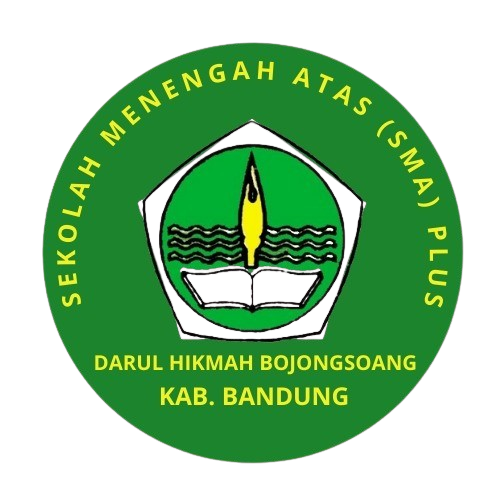

<p align="center">
  
</p>

<h1 align="center">Sistem Informasi PPDB Online<br>SMA Darul Hikmah</h1>

<p align="center">
  Aplikasi Penerimaan Peserta Didik Baru (PPDB) Online berbasis web yang mempermudah proses pendaftaran mandiri calon siswa, verifikasi berkas digital, pengumuman hasil seleksi otomatis via email dan in-app notification, serta pelaporan data pendaftar bagi panitia sekolah.
</p>

<p align="center">
  <a href="https://github.com/PahniHanawan/PPDB-SMA-DARUL-HIKMAH/stargazers"></a>
  <a href="https://github.com/PahniHanawan/PPDB-SMA-DARUL-HIKMAH/network/members"></a>
  <a href="https://laravel.com"></a>
  <a href="https://www.php.net"></a>
  <a href="https://tailwindcss.com"></a>
  <a href="https://getbootstrap.com"></a>
  <a href="LICENSE"></a>
</p>

---

## 📌 Daftar Isi
- [Tentang Proyek](#-tentang-proyek)
- [Fitur Utama](#-fitur-utama)
- [Alur Pendaftaran (Workflow)](#-alur-pendaftaran-workflow)
- [Teknologi yang Digunakan](#-teknologi-yang-digunakan)
- [Kebutuhan Sistem](#-kebutuhan-sistem)
- [Panduan Instalasi & Menjalankan](#-panduan-instalasi--menjalankan)
- [Akun Default untuk Uji Coba](#-akun-default-untuk-uji-coba)
- [Struktur Direktori](#-struktur-direktori)
- [Kontribusi](#-kontribusi)
- [Lisensi](#-lisensi)

---

## 📖 Tentang Proyek

**Sistem PPDB Online SMA Darul Hikmah** adalah platform digital untuk memodernisasi proses seleksi dan penerimaan siswa baru di lingkungan SMA Darul Hikmah. 

Sebelumnya, pengumpulan berkas dan pengumuman seleksi dilakukan secara manual dan tatap muka. Aplikasi ini hadir untuk:
1. **Mengefisiensikan waktu dan biaya pendaftaran** bagi calon peserta didik dan wali murid.
2. **Menyederhanakan tugas panitia seleksi** dalam memvalidasi berkas, memeriksa nilai, dan merilis hasil seleksi secara real-time.
3. **Meningkatkan transparansi dan akurasi data** melalui pencetakan bukti pendaftaran berformat PDF, ekspor data pendaftar ke spreadsheet Excel, dan notifikasi pengumuman via email resmi.

---

## 🌟 Fitur Utama

### 🎓 1. Portal Calon Peserta Didik (CPD)
- **Registrasi & Autentikasi Mandiri**: Akun aman berbasis Laravel Breeze dengan pembagian hak akses pengguna.
- **Formulir Pendaftaran Multi-Langkah (Multi-Step Wizard)**:
  - **Step 1 - Data Siswa**: Pengisian NISN, NIK, nama lengkap, tempat/tanggal lahir, jenis kelamin, agama, alamat, asal sekolah, kontak, dan nilai rata-rata rapor.
  - **Step 2 - Data Orang Tua / Wali**: Pengisian data lengkap ayah dan ibu (NIK, nama, tempat/tanggal lahir, pekerjaan, penghasilan bulanan, kontak, dan alamat).
  - **Step 3 - Unggah Dokumen Digital**: Fasilitas upload berkas persyaratan (Kartu Keluarga, Akta Kelahiran, Ijazah/SKL, Rapor Semester 1–5, Pas Foto Formal, Sertifikat Prestasi).
- **Monitoring Status Pendaftaran**: Informasi status terkini (**Pending**, **Diterima**, atau **Ditolak**) disertai progress bar status seleksi.
- **Unduh Bukti Pendaftaran (PDF)**: Cetak otomatis bukti pendaftaran resmi berformat PDF berlogo sekolah yang dilengkapi nomor pendaftaran dan rincian data calon siswa.
- **Sistem Notifikasi Terintegrasi**:
  - **In-App Notification**: Ikon lonceng di navbar dengan penghitung *unread badge*, drop-down pratinjau pesan, dan opsi tandai telah dibaca.
  - **Notifikasi Email**: Calon peserta didik menerima email otomatis saat panitia memperbarui status seleksi mereka.

### 🛡️ 2. Panel Administrator & Panitia PPDB
- **Dashboard Statistik & Ringkasan**: Pemantauan jumlah total pendaftar, siswa diterima, ditolak, dan status menunggu verifikasi (*pending*).
- **Manajemen Pendaftar Lengkap**:
  - Filter pencarian nama/NISN dan pengurutan data pendaftar.
  - Halaman detail pendaftar lengkap dengan pratinjau (*preview*) dokumen berkas persyaratan yang diunggah.
  - **Update Status AJAX Real-time**: Pengubahan status pendaftaran secara interaktif menggunakan AJAX dan konfirmasi SweetAlert2 tanpa *reload* halaman.
  - Otomatis memicu pengiriman notifikasi (*Database Notification* dan *Mail Message*) ke akun calon siswa terkait.
- **Laporan & Ekspor Data**:
  - Cetak rekapitulasi data pendaftar berformat **PDF** (`barryvdh/laravel-dompdf`).
  - Ekspor daftar calon siswa yang dinyatakan diterima ke format **Excel (.xlsx)** (`maatwebsite/excel`) dan **PDF (.pdf)**.
- **Manajemen Pengguna (User Management)**:
  - Kelola seluruh data pengguna terdaftar.
  - Ubah peran (*role*) akun antara `admin` dan `user`.
  - Edit identitas profil, perbarui password, dan hapus akun pengguna.

### 🌐 3. Halaman Publik & Informasi Sekolah
- **Landing Page Interaktif**: Menampilkan profil sekolah, sambutan, visi, misi, dan informasi pendaftaran.
- **Fasilitas & Program Unggulan**: Galeri dan rincian sarana prasarana sekolah.
- **Informasi Ekstrakurikuler**: Daftar kegiatan kesiswaan (Pramuka, Paskibra, Seni Budaya, Olahraga, dsb.).

---

## 🔄 Alur Pendaftaran (Workflow)

```mermaid
flowchart TD
    A([Calon Siswa Mengunjungi Web]) --> B[Registrasi / Buat Akun]
    B --> C[Login ke Sistem]
    C --> D[Isi Step 1: Data Diri Siswa]
    D --> E[Isi Step 2: Data Orang Tua / Wali]
    E --> F[Isi Step 3: Unggah Berkas & Dokumen]
    F --> G[Pendaftaran Terkirim (Status: Pending)]
    
    G --> H{Admin / Panitia PPDB Memverifikasi}
    H -->|Data Valid & Lolos Seleksi| I[Status: Diterima]
    H -->|Data Tidak Sesuai| J[Status: Ditolak]
    H -->|Perlu Ditinjau Ulang| K[Status: Pending]

    I --> L[Kirim Notifikasi In-App & Email]
    J --> L
    K --> L
    
    L --> M[Siswa Melihat Pengumuman di Dashboard]
    M --> N[Siswa Mengunduh Formulir Bukti PDF]
    H --> O[Admin Ekspor Laporan Excel / PDF]
```

---

## 💻 Teknologi yang Digunakan

| Kategori | Teknologi | Deskripsi / Penggunaan |
| :--- | :--- | :--- |
| **Backend Framework** | [Laravel 11.x](https://laravel.com) | Framework PHP modern dengan arsitektur MVC |
| **Bahasa Pemrograman**| [PHP 8.2+](https://php.net) | Bahasa pemrograman utama |
| **Database** | [MySQL](https://mysql.com) / SQLite | Penyimpanan data relasional aplikasi |
| **Autentikasi** | [Laravel Breeze](https://laravel.com/docs/starter-kits#laravel-breeze) | Sistem autentikasi ringan, bersih, dan aman |
| **Styling & UI** | [Tailwind CSS](https://tailwindcss.com) & [Bootstrap 5](https://getbootstrap.com) | Kombinasi utilitas modern dan layout responsif |
| **Admin Template** | [AdminLTE 3](https://adminlte.io) | Dashboard panel untuk pengelolaan admin |
| **Interaktivitas UI** | [Alpine.js](https://alpinejs.dev) & [SweetAlert2](https://sweetalert2.github.io) | Dropdown dinamis, interaktivitas modal, dan dialog konfirmasi |
| **Ekspor Dokumen** | [Laravel DomPDF](https://github.com/barryvdh/laravel-dompdf) | Pembuatan file PDF formulir pendaftaran & laporan |
| **Ekspor Spreadsheet**| [Laravel Excel (Maatwebsite)](https://laravel-excel.com) | Ekspor daftar siswa diterima ke format .xlsx |
| **Bundler / Build** | [Vite](https://vitejs.dev) | Modern frontend asset bundler |

---

## ⚙️ Kebutuhan Sistem

Sebelum menjalankan proyek ini, pastikan komputer Anda telah terinstal:
- **PHP** >= 8.2 (dengan ekstensi: `pdo`, `mbstring`, `openssl`, `tokenizer`, `xml`, `ctype`, `json`, `gd`, `fileinfo`)
- **Composer** >= 2.x
- **Node.js** >= 18.x & **NPM**
- **Web Server & Database**: Laragon / XAMPP / Native MySQL

---

## 🚀 Panduan Instalasi & Menjalankan

Ikuti langkah-langkah berikut untuk menjalankan proyek di komputer lokal:

### 1. Clone Repository
```bash
git clone https://github.com/PahniHanawan/PPDB-SMA-DARUL-HIKMAH.git
cd PPDB-SMA-DARUL-HIKMAH
```

### 2. Install Dependensi PHP (Composer)
```bash
composer install
```

### 3. Install Dependensi JavaScript (NPM)
```bash
npm install
```

### 4. Konfigurasi File Environment (`.env`)
Salin file `.env.example` menjadi `.env`:
```bash
cp .env.example .env
```
*(Di Windows Command Prompt bisa menggunakan `copy .env.example .env`)*

Buka file `.env` lalu sesuaikan konfigurasi database Anda:
```env
APP_NAME="PPDB SMA Darul Hikmah"
APP_URL=http://127.0.0.1:8000

DB_CONNECTION=mysql
DB_HOST=127.0.0.1
DB_PORT=3306
DB_DATABASE=ppdb_darul_hikmah
DB_USERNAME=root
DB_PASSWORD=
```

> **Opsional (Konfigurasi Email Notification):**
> Untuk menguji fitur notifikasi email saat status pendaftaran diubah, isi kredensial SMTP pada `.env` (misal menggunakan [Mailtrap](https://mailtrap.io) untuk development atau Gmail SMTP):
> ```env
> MAIL_MAILER=smtp
> MAIL_HOST=sandbox.smtp.mailtrap.io
> MAIL_PORT=2525
> MAIL_USERNAME=your_username
> MAIL_PASSWORD=your_password
> MAIL_FROM_ADDRESS="no-reply@smadarulhikmah.sch.id"
> MAIL_FROM_NAME="${APP_NAME}"
> ```
> *Jika tidak ingin mengirim email saat development lokal, Anda dapat mengatur `MAIL_MAILER=log`.*

### 5. Generate Application Encryption Key
```bash
php artisan key:generate
```

### 6. Jalankan Migrasi Database & Seeder
Buat database bernama `ppdb_darul_hikmah` di MySQL (via phpMyAdmin / HeidiSQL / CLI), lalu jalankan perintah berikut:
```bash
php artisan migrate --seed
```
*Perintah di atas akan mengeksekusi migrasi tabel dan membuat akun administrator awal secara otomatis.*

### 7. Buat Symbolic Link Storage
Untuk memastikan berkas dan dokumen yang diunggah dapat diakses oleh sistem:
```bash
php artisan storage:link
```

### 8. Jalankan Server Pengembangan
Buka dua terminal terpisah (atau gunakan satu terminal dengan concurrently):

**Terminal 1 (Laravel Development Server):**
```bash
php artisan serve
```

**Terminal 2 (Vite Asset Compilation):**
```bash
npm run dev
```

Buka peramban (*browser*) Anda dan akses:
```
http://127.0.0.1:8000
```

---

## 🔑 Akun Default untuk Uji Coba

Setelah menjalankan seeder database, Anda dapat login menggunakan akun berikut:

| Peran (*Role*) | Email | Password | Hak Akses |
| :--- | :--- | :--- | :--- |
| **Administrator** | `hikmah@darul.com` | `darulhikmah2025` | Akses penuh dashboard, verifikasi pendaftar, ekspor laporan, ubah status, kelola user |
| **Calon Siswa (User)** | *(Registrasi mandiri di menu Register)* | *(Sesuai input saat registrasi)* | Mengisi formulir PPDB 3 langkah, cek status, unduh berkas pendaftaran PDF |

---

## 📂 Struktur Direktori

Berikut adalah gambaran ringkas struktur file dan direktori penting:

```
PPDB-SMA-DARUL-HIKMAH/
├── app/
│   ├── Exports/                  # Class ekspor data Excel & PDF (Maatwebsite/Excel)
│   │   ├── PendaftaranExport.php
│   │   └── PendaftarDiterimaExport.php
│   ├── Http/
│   │   ├── Controllers/          # Logika aplikasi (Dashboard, Pendaftaran, User, Notifikasi, dsb.)
│   │   └── Middleware/           # Middleware hak akses (Admin, CekPendaftaran)
│   ├── Models/                   # Model Eloquent (User, Pendaftaran, Orangtua, Dokumen)
│   └── Notifications/            # Notifikasi multi-channel (In-App DB & Email Pengumuman)
├── config/                       # Konfigurasi aplikasi, mail, database, excel, pdf
├── database/
│   ├── migrations/               # Skema tabel database
│   └── seeders/                  # Seeder akun default admin
├── public/                       # Aset publik, logo, gambar, plugin AdminLTE, file unggahan
├── resources/
│   ├── css/ & js/                # Asset frontend Vite
│   └── views/                    # Template Blade (Admin views, CPD views, Email template, PDF format)
├── routes/
│   ├── web.php                   # Routing web & proteksi middleware
│   └── auth.php                  # Routing otentikasi akun
├── .env.example                  # Template variabel lingkungan
├── composer.json                 # Manajemen paket PHP
└── package.json                  # Manajemen paket Node.js
```

---

## 🤝 Kontribusi

Kontribusi selalu disambut dengan baik! Jika Anda memiliki saran atau menemukan perbaikan:
1. **Fork** repository ini.
2. Buat branch fitur baru (`git checkout -b feature/FiturBaru`).
3. Commit perubahan Anda (`git commit -m 'Menambahkan Fitur Baru'`).
4. Push ke branch Anda (`git push origin feature/FiturBaru`).
5. Buat **Pull Request**.

---

## 📄 Lisensi

Proyek ini didistribusikan di bawah lisensi terbuka [MIT License](LICENSE). Anda bebas menggunakan, memodifikasi, dan mengembangkan kode ini untuk keperluan edukasi maupun institusi.

---

<p align="center">
  Dibuat dengan ❤️ untuk kemajuan pendidikan di <b>SMA Darul Hikmah</b>.
</p>
